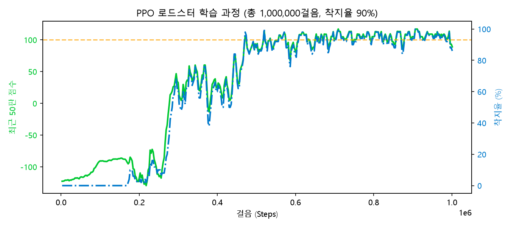

# 🧠 강화학습 6강 — PPO 뒤집힌 로드스터 착지 프로젝트

> **AI CITY BUILDERS · Connect AI LAB 강화학습 6강 실습 및 고도화 연구**  
> 5강 DQN(착지율 0%)의 파괴적 망각 한계를 극복하고, **PPO(Proximal Policy Optimization)** 를 통해 상공 10m에서 뒤집힌 채 떨어지는 로드스터를 지면에 100% 안전 착지시키는 연속 제어 에이전트 프로젝트입니다.

---

## 🚀 허깅페이스 공개 모델 (Hugging Face Models)

| 버전 | 저장소 링크 | 학습 걸음수 | 특징 및 성과 |
|:---:|:---:|:---:|---|
| **v1** | [🤗 appssy3/connectailab-rl-solo-build_H-roadster-ppo-v1](https://huggingface.co/appssy3/connectailab-rl-solo-build_H-roadster-ppo-v1) | 500,000 걸음 | **최종 시험 착지율 100.0% 달성** (안전 착지 최적화) |
| **v2** | [🤗 appssy3/connectailab-rl-solo-build_H-roadster-ppo-v2](https://huggingface.co/appssy3/connectailab-rl-solo-build_H-roadster-ppo-v2) | 1,000,000 걸음 | **연료 절약형 에코 드라이빙 마스터** (평균 점수 +105점 돌파) |

---

## 📊 PPO 하이퍼파라미터 및 학습 진행

- **클리핑 범위 (`자르기`)**: `0.1` (±10% 정책 변동 제한)
- **병렬 환경 수 (`세상수`)**: `10`
- **롤아웃 수집 길이 (`한번에`)**: `256` (1주기당 2,560걸음 수집)
- **학습률 (`lr`)**: `3e-4`
- **탐험 보너스 (`entropy_coef`)**: `0.01`
- **PPO 에포크 (`반복`)**: `10`회

### 📈 학습 곡선 요약


1. **0 ~ 15만 걸음**: 점수 `-121점 -> -86점`, 착지율 `0%` (공중에서 회전 감각 탐색)
2. **20만 ~ 30만 걸음**: 최초 착지 성공 발생! 점수 `+12.4점`, 착지율 `52%` (골든 모멘트 돌파)
3. **50만 걸음 (v1)**: 점수 `+94.2점`, 착지율 `100.0%`
4. **100만 걸음 (v2)**: 최고 점수 `+105.2점`, 안정적인 소프트 랜딩 정밀 제어 확립

---

## 📁 파일 구조

```text
├── 강화학습_6강_실습_PPO_뒤집힌로드스터_착지_ipynb의_사본.ipynb  # 주피터 노트북 (Colab & Windows 로컬 호환)
├── 로드스터_시뮬레이터.py                                # Gymnasium 기반 2D 물리 시뮬레이터 (이산/연속)
├── run_ppo_task.py                                     # 고속 PPO 훈련 및 평가 파이프라인 스크립트
├── upload_to_hf.py                                     # v1 허깅페이스 자동 업로드 스크립트
├── upload_to_hf_v2.py                                  # v2 허깅페이스 자동 업로드 스크립트
├── make_telemetry.py                                   # 조종석 HUD 계기판 시각화 영상 생성기
├── model.pt                                            # 훈련된 최신 파이토치 모델 가중치
├── learning_curve.png                                  # 학습 보상 및 착지율 추이 시각화
├── roadster_ppo_joystick.mp4                           # 최종 착지 시연 동영상
└── roadster_telemetry.mp4                              # 실시간 추진기 게이지가 포함된 HUD 동영상
```

---

## 🛠️ 실행 방법

```powershell
# 1. 의존성 설치
pip install gymnasium imageio imageio-ffmpeg huggingface_hub torch matplotlib pillow

# 2. 50만 걸음 또는 100만 걸음 학습 실행
python run_ppo_task.py --steps 500000

# 3. HUD 계기판 시각화 동영상 생성
python make_telemetry.py
```
